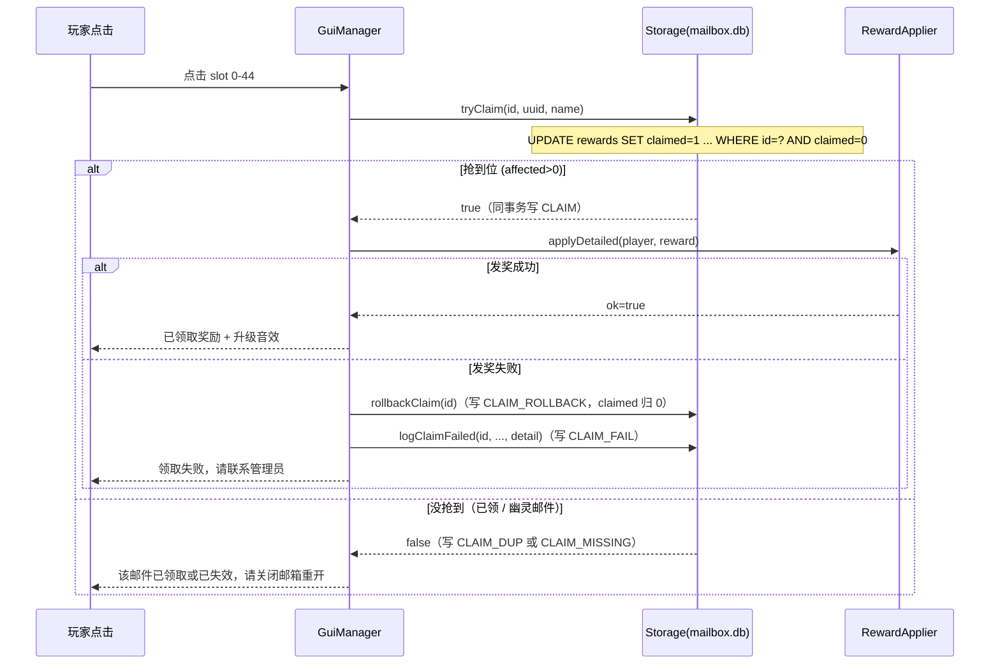

# PumpkinMail —— 南瓜邮箱（自研）

> 活动奖励的**发放—领取—对账**三件套：管理员一键批量发放，玩家上线在 GUI 领取，每一笔都进只追加的审计流水，能与南瓜账本交叉核对。一次性搭建，长期复用。

| 项             | 值                                                                                |
| -------------- | --------------------------------------------------------------------------------- |
| 插件名         | `PumpkinMail`（对外称**南瓜邮箱**）                                                |
| **实跑版本**   | **`1.1.1`**——`plugin.yml`（源码与 jar 内嵌）、根目录 jar、`target/`、`自研/lib/` 四处已于 2026-11-19 **全部对齐 1.1.1**，详见 §十 |
| 主类           | `com.nangua.pumpkinmail.PumpkinMail`                                              |
| 包名           | `com.nangua.pumpkinmail`                                                          |
| `api-version`  | `26.3`（Leaf 26.3）                                                               |
| 命令 / 别名    | `/mailbox` / `pmail`                                                              |
| 权限           | `pumpkinmail.admin`（默认 `op`；除玩家开自己邮箱外，所有子命令都需要）             |
| 数据文件       | `plugins/PumpkinMail/mailbox.db`（SQLite，三表）                                   |
| 运行时依赖     | SQLite JDBC（由 Leaf 服务端 `libraries/` 提供）；`eco give` 走 EssentialsX/Vault    |
| 软调依赖       | MoneyLedger（反射写来源备注，缺失不影响）                                          |
| 被谁依赖       | **BuildRate、OfflineReward** 编译期引用 `自研/lib/PumpkinMail.jar`，运行时 `softdepend` |
| 实跑位置       | 主服 `leaf-26.3-多服/plugins/PumpkinMail-1.1.1.jar`                                |

---

## 一、为什么做这个

运营活动最常见的死循环是：**「奖励发了没？」**

靠 `eco give` 挨个点、靠聊天记录追溯，一次比赛几十人就没法收场；更糟的是「命令执行失败但管理员以为发成功了」。南瓜邮箱把这件事拆成三个确定动作：

1. **发放**——按奖品预设 + 名单批量投递，异步执行不卡主线程，每投一封邮箱邮件就是一行 `rewards` 记录；
2. **领取**——玩家上线被 ActionBar 提示，`/mailbox` 开界面点一下拿东西，未领的**永不删除**；
3. **对账**——每一笔发放/领取/失败都进只追加的 `reward_log`，`/mailbox verify` 能查有没有漏流水、金额对不对得上、必填字段齐不齐。

它同时也是**其他自研插件的发奖出口**：BuildRate 的建筑赛奖励、OfflineReward 的在线/离线奖励都调它的 `Storage.addReward()`，所以「奖励从哪儿来的」这件事在数据库里始终有统一答案。

---

## 二、玩家侧怎么用

### 2.1 入口与提示

- `/mailbox`（或 `pmail`）打开自己的邮箱界面；
- 有待领奖励时会被提示，走 `hint` 配置：

| 配置                       | 默认值 | 行为                                                             |
| -------------------------- | ------ | ---------------------------------------------------------------- |
| `hint.enabled`             | `true` | 总开关；关掉则上线也不提示                                        |
| `hint.on-join-only`        | `true` | **只在进服时提醒一次**，不再定时循环刷屏                          |
| `hint.interval-seconds`    | `30`   | 仅当 `on-join-only: false` 时生效；设为 `0` 同样表示只提醒一次     |

上线提示延后 `40 tick`（2 秒）发送，避开进服瞬间被其他插件的 ActionBar 冲掉。数量为 0 时**完全静默**，不刷屏。提示文案：`你有 N 条待领取奖励，输入 /mailbox 领取`。

### 2.2 邮箱界面

`6×27 + 顶栏` 的箱子 GUI（标题 `南瓜邮箱`，Java 与基岩共用——Geyser 原生渲染 Bukkit 箱子界面，不需要单独做基岩表单）：

| 槽位          | 内容                                                     |
| ------------- | -------------------------------------------------------- |
| `0 – 44`      | 奖励图标，每页最多 **45** 条，按发放时间正序              |
| `45 – 47`     | 装饰玻璃板                                                |
| `48`          | `« 上一页`（首页时不显示）                                |
| `49`          | `关闭`（屏障图标）                                        |
| `50`          | `下一页 »`（有下一页时才显示）                            |

界面所有点击都被 `cancelled`，玩家拿不走图标；`refreshMailbox` 在领取后重查数据库并重绘，越界页码自动收敛。关掉界面 / 退出服务器会清掉该玩家的会话缓存——但**只清正在关闭的那个界面对应的会话**，奖品库→选对象这类界面切换不会把新会话误清掉（`onClose` 里比对 `Inventory` 实例）。

---

## 三、领取链路：先占位，后发奖（防重复领取的核心）

这是本插件最要紧的设计，1.1.1 把它做成刚性流程：



**为什么要这么绕**：GUI 里缓存的是打开那一刻的 `Reward` 列表。玩家开着界面不动，另一头管理员重复发放 / 数据库这条已经不在，直接按缓存发钱就会出现「反复点、反复得币」。`tryClaim` 用 `WHERE claimed=0` 做**数据库层原子条件更新**，抢不到位就一律不发钱；真去发奖失败时又必须 `rollbackClaim` 把占位退回去，玩家可以重试，也不会有人因为一次命令失败就永久丢掉奖励。

---

## 四、三种奖品类型与发放细节

预设类型 `rewardType` 只有三种：`money` / `item` / `command`（`Preset.summary()` 决定菜单里怎么显示）。

| 类型    | 实际动作                                                 | 说明                                    |
| ------- | -------------------------------------------------------- | --------------------------------------- |
| `money` | 控制台执行 `eco give <玩家> <金额>`                       | 即南瓜币，会同步进南瓜账本               |
| `item`  | **直接调背包 API 发放**（不再拼 `give` 命令）             | 见下方「为什么不走 give」                |
| `command` | 把 `data` 里的 `{player}` 换成玩家名后以控制台身份执行 | 任意命令，适合点券 / 权限组 / 自定义礼包  |

### 4.1 为什么 item 不再走 `give` 命令

服务器 `commands.yml` 把 `give` 别名强制指向原版 `minecraft:give`，而原版资源名只接受小写 `a-z0-9_.-`。像 `DIAMOND:64` 这种写法会被解析成空的物品 path，抛 `Unknown item 'minecraft:'`。

直接调用 `Inventory` API 一次绕开**命令别名、大小写、EssentialsX 覆盖、1.20.5+ 物品组件化**这四层坑，基岩端（Floodgate 前缀名）同样适用。`reward.item-command` 配置项保留但**已不再实际使用**，仅作格式说明。

### 4.2 物品数据写法（`RewardApplier.parseItem`）

大小写、带不带命名空间都认：

```
DIAMOND              → 钻石 ×1
diamond              → 同上
DIAMOND:64           → 钻石 ×64
golden_apple:2       → 金苹果 ×2
minecraft:diamond    → 钻石 ×1
minecraft:diamond:64 → 钻石 ×64（数量从最后一个冒号切，命名空间再单独剥离）
```

实现要点：数量段必须是纯数字才算数量，否则整串当材质；`minecraft:` 前缀剥离是必要的——`Material.matchMaterial` 会把 `:` 当成非法字符清掉。数量被夹到 `[1, maxStackSize]`，识别不出材质返回 `null` 并记日志。

**背包放不下不会凭空消失**：`addItem` 的剩余物按 `dropItemNaturally` 掉在玩家脚边，并提示「背包已满，多余的 N 个物品已掉落在你脚边」。

### 4.3 异常约定（很重要）

`RewardApplier` **吞掉一切异常并返回 `ApplyResult(ok, detail)`，绝不向外抛**。原因很实际：一旦异常冒到上层，`markClaimed()` 就不会执行，奖励永远停在「未领取」，玩家可以反复点击反复领取。

`detail`（如「物品解析/发放失败：xxx」「eco give 执行失败（金额=500）」「未知奖励类型：monoy」）会原样写进审计流水，排查漏发时直接可读。

### 4.4 与南瓜账本的联动

发奖前用反射调 `MoneyLedger.setReason(奖励描述)`，发完再 `setReason(null)` 清掉。于是玩家领取成功时，**账本里那笔南瓜币的来源就带着活动名**（例：`建筑大赛第1名：500 南瓜币`）。

账本插件没装时反射失败被静默忽略，邮箱照常工作。调用必须成对，否则上一笔备注会串到下一笔（1.1.0 账本已修清除逻辑）。

---

## 五、命令手册

| 指令                                              | 需要 admin | 作用                                                              |
| ------------------------------------------------- | :--------: | ----------------------------------------------------------------- |
| `/mailbox`                                        |     否     | **玩家**打开自己的邮箱（控制台执行会提示请在游戏内执行）            |
| `/mailbox admin`                                  |     是     | 打开批量发放面板（必须玩家执行，控制台无法开 GUI）                  |
| `/mailbox give <奖品ID> <名单>`                    |     是     | 命令行一键批量发放，异步执行                                        |
| `/mailbox preset add <ID> money <金额> [备注]`     |     是     | 新建/覆盖货币奖品                                                   |
| `/mailbox preset add <ID> item <材质[:数量]> [备注]` |  是     | 新建/覆盖物品奖品                                                   |
| `/mailbox preset add <ID> command <指令...>`       |     是     | 新建/覆盖命令奖品（`{player}` = 玩家名；备注取奖品 ID）             |
| `/mailbox preset list`                            |     是     | 列出奖品库（含摘要）                                                |
| `/mailbox preset remove <ID>`                     |     是     | 删除奖品                                                            |
| `/mailbox list <玩家>`                            |     是     | 查看某玩家全部奖励（含已领，带状态/发放人/时间）                     |
| `/mailbox stats`                                  |     是     | 邮件总数 / 待领 / 已领 + 审计事件计数                               |
| `/mailbox log [玩家] [条数]`                      |     是     | 审计流水；不带玩家 = 全服，默认 20 条，**上限 200**                 |
| `/mailbox verify`                                 |     是     | 对账（见 §八）                                                     |
| `/mailbox reload`                                 |     是     | 重载 `config.yml`（只影响提示配置；表结构无需重载）                 |

Tab 补全：子命令 → `give/preset/admin/list/stats/log/verify/reload`；`give` 第二参数补奖品 ID、第三参数补 `@online / @whitelist / @file:`；`log` 第二参数补在线玩家名。无 `pumpkinmail.admin` 时补全返回空。

### 5.1 名单（target）四种写法

| 写法              | 含义                                                       |
| ----------------- | ---------------------------------------------------------- |
| `@online`         | 当前全部在线玩家                                            |
| `@whitelist`      | 服务器白名单玩家                                            |
| `@file:<路径>`    | 逐行读名单：空行和 `#` 开头的行跳过；**相对路径基于插件目录**（如 `data/名单.txt`），文件不存在只打日志并返回空 |
| `名字,名字,名字`  | 逗号分隔；每项会 `trim()`，空项跳过                          |

GUI「选对象」页（27 格）：`0` 在线玩家、`1` 白名单玩家、`2` 名单文件、`3` 手动输入名单、`8` 返回奖品库、`26` 关闭。选 2/3 会关闭界面并等玩家**在聊天栏输入**（`ChatInput`：`AsyncPlayerChatEvent` 最低优先级拦截，消息不外泄，输入 `cancel` 取消），随后再走异步发放。

### 5.2 发放是异步的

名单解析、UUID 解析、SQLite 写入全在异步线程，完成后回主线程提示，**不会因几百人名单卡住主线程 TPS**。命令入口标渠道 `COMMAND`，GUI 入口标 `GUI`，审计里 `source = 渠道:发放人`。

返回值是**实际写入条数**（去重失败或写库失败不计），所以 `已向 N 名玩家发放` 里的 N 是真数字；`N=0` 时提示检查奖品 ID 或名单有效性。

### 5.3 UUID 策略：宁缺毋伪

```1. 在线玩家 → Bukkit.getPlayerExact 精确匹配，取真实 UUID
2. 不在场    → 只认本服已有档案（OfflinePlayer.hasPlayedBefore()）
3. 都拿不到  → 留 null，按玩家名照样能领；绝不写离线模式伪造 UUID```

这条纪律的意义：伪造 UUID 一旦写进库，将来同一账号换正版/基岩身份时对不上，审计会变成误导。邮箱按「名字或 UUID 命中」取待领（`getPending` 的 `player_name = ? COLLATE NOCASE OR player_uuid = ?`），所以留空不损害玩家领取能力，只影响精确度。

---

## 六、数据结构

`plugins/PumpkinMail/mailbox.db`（SQLite，`PRAGMA journal_mode=WAL` + `synchronous=NORMAL` + `busy_timeout=5000`）

### 6.1 `presets`——奖品库

| 字段           | 类型    | 说明                                  |
| -------------- | ------- | ------------------------------------- |
| `id`           | TEXT PK | 奖品 ID（发放时引用）                  |
| `reward_type`  | TEXT    | `money` / `item` / `command`          |
| `data`         | TEXT    | 金额 / `材质[:数量]` / 命令串          |
| `desc`         | TEXT    | 备注，会显示给玩家并写入账本来源        |
| `created_time` | INTEGER | 建时间，`listPresets` 按它排序          |

`INSERT OR REPLACE`，同 ID 再 `add` = 覆盖。

### 6.2 `rewards`——玩家邮箱条目（每封邮件一行，**永不删除**）

| 字段           | 类型    | 说明                                                        |
| -------------- | ------- | ----------------------------------------------------------- |
| `id`           | TEXT PK | 每封邮件随机 UUID（`INSERT OR IGNORE`，重复 id 被去重）       |
| `player_uuid`  | TEXT    | 真实 UUID，可为 NULL（见 §5.3）                              |
| `player_name`  | TEXT    | 主查询字段（不区分大小写）                                    |
| `preset_id`    | TEXT    | 来源奖品 ID                                                  |
| `reward_type` / `data` / `desc` | | 发放时刻的**快照**，之后改预设不影响已发邮件            |
| `issued_by`    | TEXT    | 发放人；空则写 `SYSTEM`                                      |
| `issued_time`  | INTEGER | 毫秒时间戳（≤0 时取当前时间）                                 |
| `claimed`      | INTEGER | 0 待领 / 1 已领                                              |
| `claimed_time` | INTEGER | 领取时间；`rollbackClaim` 会清回 NULL                         |
| `source`       | TEXT    | **1.1.0 新增**：来源分类，见 §6.4                            |
| `claimed_by`   | TEXT    | **1.1.0 新增**：领取人 UUID                                    |
| `claimed_name` | TEXT    | **1.1.0 新增**：领取人名                                       |

索引 `idx_rewards_player (player_name, claimed)`。领取只更新状态，从不 `DELETE`——历史邮件的可追溯性优先。

### 6.3 `reward_log`——全量审计流水（**只追加，不删除**，无开关）

| 字段                             | 说明                                              |
| -------------------------------- | ------------------------------------------------- |
| `id`                             | 自增主键                                          |
| `reward_id`                      | 关联 `rewards.id`                                  |
| `event`                          | 事件类型（下表 7 类）                              |
| `event_time`                     | 毫秒时间戳                                        |
| `player_uuid` / `player_name`    | 对象（真实 UUID，拿不到留空）                      |
| `issued_by` / `source`           | 谁发的 / 什么渠道                                  |
| `reward_type` / `data` / `desc`  | **真实奖励内容**，用于和账本逐项核对               |
| `detail`                         | 结果说明（发放成功 / 被去重原因 / 失败原因 / 迁移标记） |

索引：`idx_log_reward(reward_id, event)`、`idx_log_player(player_name, event_time)`、`idx_log_time(event_time)`。

**事件类型（源码实况 7 类）**：

| 事件              | 触发时机                                                      | 是否影响发放结果        |
| ----------------- | ------------------------------------------------------------- | ----------------------- |
| `ISSUE`           | 邮件成功写入                                                  | 计入选中人数            |
| `ISSUE_DUP`       | `rewards.id` 已存在被 `INSERT OR IGNORE` 去重                  | **不计入**，不算失败     |
| `CLAIM`           | 领取成功（占位即成功，detail=`领取成功（先占位后发奖）`）        | —                       |
| `CLAIM_DUP`       | 重复点击 / 已领过，`WHERE claimed=0` 影响行数 0                 | 拒绝发奖                |
| `CLAIM_MISSING`   | 库里找不到该 `reward_id`（幽灵邮件）                           | 拒绝发奖                |
| `CLAIM_ROLLBACK`  | 已占位但发奖失败，占位退回、允许重试                           | 奖励回到待领            |
| `CLAIM_FAIL`      | 发奖失败的具体原因（命令失败 / 材质解析失败 / 未知类型）         | 与 ROLLBACK 成对出现     |

> 注：`config.yml` 的事件注释原先（1.1.0 时期）只列了 6 类，2026-11-19 已补上 `CLAIM_ROLLBACK` 并同步到运行服，现与本表一致（7 类）。

### 6.4 `source` 是推断出来的

`inferSource(发放人, 奖品ID)`：

```
issued_by = "OfflineReward"  →  OfflineReward:<preset_id 或 unknown>
issued_by = "BuildRate"      →  BuildRate
其他                          →  MANUAL:<发放人>
```

由插件发放时 `source` 精确到「哪一个奖励预设」，人工发放时至少精确到「哪个人」。旧库首次启动用 `backfillSource()` 按同一规则把 `source` 列填上。

---

## 七、旧库自动迁移（幂等，原字段一条不改写）

首次 `open()` 顺序执行：

1. `CREATE TABLE IF NOT EXISTS` 三张表 + 索引 + PRAGMA；
2. `migrateColumns()`：用 `PRAGMA table_info(rewards)` 判断，缺就 `ALTER TABLE ADD COLUMN` 补 `source` / `claimed_by` / `claimed_name`（SQLite 不支持 `IF NOT EXISTS` 加列，只能先查再改）；
3. `backfillSource()`：只填 `source` 为空的历史行（§6.4 规则），其他列不动；
4. `backfillLog()`：给迁移前已有邮件补 `ISSUE` / `CLAIM` 审计事件，用 `NOT EXISTS` 做幂等——**每次启动都跑也只补缺失的**，`detail` 标记为 `BACKFILL:迁移前历史发放` / `BACKFILL:迁移前历史领取`。

设计原则：审计体系上线前的历史发放/领取也要能进流水，否则「全量审计」名不副实；但**不能篡改历史业务字段**，也不该臆测当时是谁触发的。

另有**二进制兼容硬约束**：`addReward(Reward)`（void）、`markClaimed(String)`、`stats()`、`listForPlayer(String)` 这些旧签名一字不改，让已编译的 OfflineReward / BuildRate **不重新编译也能继续调用**（旧签名内部委托到新实现：`addReward → addRewardLogged(r, null)`，`markClaimed(id) → markClaimed(id, null, null)`）。

---

## 八、对账与统计

### 8.1 `/mailbox verify` 的九项检查

```
邮件总数 / 审计事件总数
缺发放流水   = rewards 有、但 reward_log 没有 ISSUE
缺领取流水   = claimed=1、但没有 CLAIM
金额不一致   = ISSUE 事件的 data 与 rewards.data 不相等
描述为空 / UUID 为空 / 来源为空 / 领取失败事件(CLAIM_FAIL) 计数
```

判定语：`missingIssue == 0 && missingClaim == 0 && wrongData == 0 && blankDesc == 0 && blankSource == 0` → `✔ 发放与领取流水完整、金额一致、必填字段齐全`，否则 `✘ 存在缺口，见上方计数（历史遗留记录请单独清洗）`。

注意：**`UUID 为空不参与判定**，因为发放时拿不到真实 UUID 属允许情况（§5.3）；`CLAIM_FAIL` 也只计数不判失败——失败已回滚为待领，不算缺流水。

### 8.2 `/mailbox stats`

两行输出：邮件总数与待领/已领（来自 `stats()` 单次 SQL 聚合），审计事件总数与 `ISSUE` / `CLAIM` / `CLAIM_FAIL` / 重复（`ISSUE_DUP + CLAIM_DUP`）计数（来自 `logStats()` 按 `event` 分组）。

理想状态：`ISSUE ≈ rewards 总数`（差额来自历史迁移前的记录），`CLAIM + CLAIM_DUP ≈ 领取点击次数`。

### 8.3 `/mailbox log`

默认倒序 20 条（时间 + id 双降序），可 `log <玩家> <条数>`，上限 200。每行格式：

```
2026-11-18 03:53:12 [CLAIM] 阿瓜 money 500 来源=GUI:管理员 发放人=管理员 建筑大赛第1名：500 南瓜币
```

---

## 九、待领数量缓存 `pendingCache`

`countPending`（供 ActionBar 提示与界面刷新用）走一层内存缓存：

- key = `player_uuid`，无 UUID 时用**小写玩家名**；
- 发放成功且该 key 已在缓存 → 自增；
- 领取 / 回滚 → 移除该 key，下次回查数据库回填；
- `onDisable` 调 `clearPendingCache()` 清空。

所有读写都在 `synchronized` 方法内、与数据库同一把锁，不出现缓存与库各写一半的竞争。价值：玩家每次进服、每次刷新界面本来都要 `COUNT(*)`（`rewards` 是逐年增长的），改成命中缓存就免查；未命中也因为有 `idx_rewards_player(player_name, claimed)` 而代价可控。

---

## 十、版本与发布状态（**含待修正项**）

核对与修正均在 2026-11-19 完成，当前状态：

| 位置                                        | 内容                        | 状态                         |
| ------------------------------------------- | --------------------------- | ---------------------------- |
| `target/PumpkinMail-1.1.1.jar`（11-18 03:52） | 内嵌 `plugin.yml version: 1.1.1` | ✅ 权威产物           |
| 主服 `plugins/PumpkinMail-1.1.1.jar`（11-18 03:53） | 实跑 1.1.1（**class major 69**，见下） | ✅ 已部署            |
| `src/main/java/**/Storage.java`（11-18 03:52:35）、`GuiManager.java`（03:52:42） | 源码即 1.1.1 | ✅ 与产物同时刻 |
| **`src/main/resources/plugin.yml`**          | `version` **已由 1.1.0 改为 1.1.1** | ✅ **本次已修正**（原来是 11-12 00:21 未跟版的遗留，下次 Maven 打包不会再退回 1.1.0） |
| **`src/main/resources/config.yml`**          | 审计事件注释**已补 `CLAIM_ROLLBACK`**，标题改为「1.1.0 起强制开启、1.1.1 补全领取占位与回滚留痕」 | ✅ **本次已修正**，键名与配置值零改动（改前后 `yaml.safe_load` 键树逐值相等） |
| 项目根目录 jar                               | **已替换为 `PumpkinMail-1.1.1.jar`**，旧 `PumpkinMail-1.1.0.jar` 已删除 | ✅ **本次已处理**（`target/` 内 1.0.0/1.1.0 作为历史留档保留） |
| `自研/lib/PumpkinMail.jar`                   | 1.1.1                       | ✅ 与根目录、`target/1.1.1` **三份 SHA256 一致（`D13B87483C3F…`）** |
| `pom.xml <version>`                          | **已由 1.0.0 改为 1.1.1**   | ✅ **本次已修正** |
| 主服 `plugins/PumpkinMail/config.yml`        | 出厂注释同步（原与源码基线逐字节同源，未含手改值） | ✅ 已同步，改动前旧文件备份为 `config.yml.bak-20261119` |

**⚠️ 一个仍存在的真实风险：字节码版本**

实跑的 `PumpkinMail-1.1.1.jar` 是 **class major 69（Java 25 字节码）**，而同服其他自研插件全部是 **major 65（Java 21）**——包括 `MoneyLedger-1.1.0`、`PumpkinFly-1.0.0`、`DailySell`、`PlanTop`、`EnchantShop`、`BuildRate`。当前服务端实跑 Java 25 能正常加载，**但一旦把服务端降回 Java 21，PumpkinMail 会第一个抛 `UnsupportedClassVersionError`，连带 BuildRate / OfflineReward 的发奖链路一起失效**。按仓库总则（`javac --release 21`）重新编译即可消除该隐患，重编前别忘了先同步 `lib/PumpkinMail.jar` 再构建下游两个插件。

### 1.1.1 相对 1.1.0 的实际变化

据当前源码与字节码差异（`Storage.class` 由 24896 → **27641 B**，`GuiManager.class` 15109 → **15290 B**，`HintTask$1.class` 1967 → 2063 B）可以确认的是：

- `Storage` 增加 **`tryClaim` / `rollbackClaim` / `logClaimFailed`** 三个方法，`markClaimed` 拆为带领取人参数的新签名（旧签名保留兼容）；事件多出 `CLAIM_ROLLBACK`；`source` / `claimed_by` / `claimed_name` 迁移与 `inferSource` 规则成型；引入 `pendingCache` 与 `baseCounts` 式批量优化。
- `GuiManager.claimReward` 改为**「先 `tryClaim` 原子占位 → 再 `applyDetailed` 发奖 → 失败 `rollbackClaim` + `logClaimFailed`」**，堵住「界面缓存旧图标反复点击反复得币」。

> 1.1.1 未在本仓库留 CHANGELOG 文档，上面是从源码与字节码尺寸对比得到的结论；若你有当时的改动清单，应以实际记录为准。

---

## 十一、目录与文件

```
南瓜邮箱-PumpkinMail/
├─ src/main/java/com/nangua/pumpkinmail/
│  ├─ PumpkinMail.java              主类：建库 / 注册 GUI 与聊天监听 / 命令 / 提示任务
│  ├─ ChatInput.java                GUI 关闭后在聊天栏接收名单或文件路径，输入 cancel 取消
│  ├─ HintTask.java                 ActionBar 待领提示（进服一次 / 可选轮询）
│  ├─ RewardApplier.java            三类奖品发放 + 物品解析 + 账本 setReason + 吞异常返回结果
│  ├─ cmd/MailboxCommand.java       /mailbox 全部子命令 + 名单解析 + 异步发放 + Tab 补全
│  ├─ gui/GuiManager.java           玩家邮箱页 / 奖品库页 / 选对象页 + 点击与领取流程
│  └─ storage/
│     ├─ Storage.java               SQLite：建表 / 迁移 / 发放 / 占位领取 / 流水 / 对账 / 缓存
│     ├─ Reward.java                一封邮件的 record（10 字段）
│     └─ Preset.java                奖品预设 record + summary() 摘要
├─ src/main/resources/
│  ├─ plugin.yml                    version 1.1.1（2026-11-19 已对齐）
│  └─ config.yml                    提示开关 / 命令模板 / 审计说明（已补 CLAIM_ROLLBACK）
├─ pom.xml                          IDE 与依赖声明（version 已改为 1.1.1）
├─ target/                          1.0.0 / 1.1.0 / 1.1.1 三代 jar
└─ PumpkinMail-1.1.1.jar            项目根留档产物（11-19 已由 1.1.0 替换，与 lib/、target/ 同哈希）
```

---

## 十二、配置

`plugins/PumpkinMail/config.yml`：

```yaml
hint:                       # 待领提示（ActionBar）
  enabled: true             # 总开关
  on-join-only: true        # 只在进服时提示一次
  interval-seconds: 30      # 仅 on-join-only: false 时生效，0 = 同样只提示一次

reward:
  money-command: "eco give {player} {amount}"     # 货币奖励实际使用
  item-command: "give {player} {material} {amount}" # 备用说明，已不再实际使用
```

改完 `/mailbox reload` 生效（`hint` 的轮询任务在 `start()` 时读取，重载后需重启才彻底重排任务；`on-join-only` 与 `enabled` 建议重启验证）。

---

## 十三、构建与联动

**编译口径**：JDK 25 的 `javac --release 21`（产物保持 Java 21 字节码，才能被服务端加载）；`pom.xml` 依赖全部 `provided`：`leaf-api 26.3.build.13-alpha`（`systemPath` 指 `../lib/`）、`sqlite-jdbc 3.53.4.0`、`adventure-api 5.2.0`、`annotations 23.0.0`；SQLite JDBC 运行时由 Leaf 的 `libraries/` 提供。

**下游插件构建顺序（重要）**：BuildRate、OfflineReward 编译期按 `自研/lib/PumpkinMail.jar` 解析 `Storage` 等类型。改完本插件后——

1. 打新版 jar；
2. **同步覆盖 `自研/lib/PumpkinMail.jar`**；
3. 再构建 BuildRate / OfflineReward。

顺序颠倒或漏掉第 2 步，下游会编译到旧签名（尤其改方法参数时直接报错）。保持 §7 的二进制兼容约定，就能只换 jar、不动下游。

---

## 十四、运维要点

1. **发奖前必做**：`/mailbox preset add` 建好奖品，或 `admin` 面板确认奖品库。`/mailbox admin` 在奖品库为空时直接提示先用 `preset add`。
2. **发放只写邮件，不给东西**——玩家不上线就永远待领；活动结算时先算待领人数，别把「已发放 = 已到账」。
3. **同 ID 重复发放会被 `INSERT OR IGNORE` 去重**并留下 `ISSUE_DUP`，不会重复入库；但同一玩家同活动的**多封邮件是允许**的（每封 `id` 是随机 UUID），要防重发得靠奖品 ID + 名单本身的可控性。
4. **改物品材质用 §4.2 任一写法均可**；`command` 类型务必带 `{player}`，否则会把同一份奖励发给执行者自己。
5. **数据文件不属于配置**，整理/汉化时 `mailbox.db` 原样保留（与仓库既有约定一致）。
6. 想核对「邮箱说发了，账本到底有没有」：`/mailbox log <玩家> 50` 看 `CLAIM` 金额，再用 `账本` 的 `/moneyledger recent <玩家> 活动/管理` 对齐——两边来源都带活动名，能逐笔咬合。

---

## 十五、常见问题

| 现象                                  | 定位                                                             |
| ------------------------------------- | ---------------------------------------------------------------- |
| 玩家说没提示                            | `hint.enabled`；`on-join-only: true` 时只上线提示一次；待领为 0 本来就静默 |
| 上线提示一闪就没了                      | 与其他插件 ActionBar 冲突，已延后 40 tick，仍被覆盖可临时改 `on-join-only: false` + 轮询 |
| 点领取提示「已领取或已失效」            | `CLAIM_DUP` 或 `CLAIM_MISSING`；界面缓存过期，关掉重开             |
| 点领取报「领取失败，请联系管理员」        | `CLAIM_FAIL`，`log` 里 `detail` 有具体原因；`money` 多为 `eco` 不可用，`item` 多为材质名不识别 |
| 物品发了但数量不对                      | 数量被夹到 `maxStackSize`；`DIAMOND:64` 正常，`DIAMOND:1000` 只发 64 |
| 背包满时物品消失                        | 不消失——`dropItemNaturally` 掉脚边；只在玩家当场死亡等极端情况才可能损失 |
| 账本里这笔看不出是哪个活动              | 邮箱已 `setReason(描述)`；若为空说明 `desc` 没填，`preset add` 务必写备注 |
| `verify` 报「缺发放流水」              | 多为 1.1.0 之前的历史邮件；`backfillLog` 会自动补，重启后复测        |
| 换了下游插件后 NoClassDefFoundError `Storage` | `lib/PumpkinMail.jar` 未与实跑版本同步，或运行目录缺 PumpkinMail |

---

## 十六、版本沿革

| 版本                | 内容                                                                                                     |
| ------------------- | -------------------------------------------------------------------------------------------------------- |
| 1.0.0（2026-11-06）  | 初版：奖品预设 + GUI 发放/领取 + `rewards` 表，无审计流水                                                  |
| 1.1.0（2026-11-12）  | **全量审计**：新增 `reward_log`（`ISSUE`/`ISSUE_DUP`/`CLAIM`/`CLAIM_DUP`/`CLAIM_FAIL`/`CLAIM_MISSING`）；发放与审计**同事务**提交，任一失败整体回滚；`rewards` 加 `source`/`claimed_by`/`claimed_name` 三列并自动迁移 + 幂等回填历史；`/mailbox log`、`verify`、`stats`（含事件计数）；发放改**异步**执行；不再伪造离线 UUID；物品发放改走背包 API（绕开 `give` 别名坑）；发奖前向南瓜账本写来源备注 |
| **1.1.1（2026-11-18）** | **领取链路原子化**：`tryClaim` 先原子占位再发奖，失败 `rollbackClaim` 退回待领并 `logClaimFailed` 留痕（新增 `CLAIM_ROLLBACK` 事件），堵住「缓存旧图标反复点击反复得币」；`markClaimed` 拆出带领取人的新签名（旧签名保留兼容）；引入 `pendingCache` 待领数量缓存并写入自增 / 领取失效；界面与会话缓存随实际关闭的界面对应清理 |

关联文档：`自研/README.md`（插件清单总表与构建总则）、`南瓜账本-MoneyLedger/使用说明.md`（`setReason` 的接收端与逐笔对账）、`建筑评分-BuildRate/使用说明.md` 与 `在线离线奖励-OfflineReward/使用说明.md`（两个下游调用方）。

---

*文档基于 2026-11-19 对源码（含 11-18 的 1.1.1 改动）、`plugin.yml`、`config.yml`、`pom.xml`、三代 jar 字节码、`自研/lib/PumpkinMail.jar` 与主服 `plugins/` 实跑产物的核对结果编写。§十 列出的 4 项版本不一致（`plugin.yml` 版本号、`config.yml` 事件注释、根目录旧 jar、`pom.xml` 版本）**已在本轮经确认后全部修正**，运行服配置同步前已留 `.bak-20261119` 备份；唯一仍待处理的是 §十 末尾那条 **major 69 字节码**风险，需重编译才能消除。*
